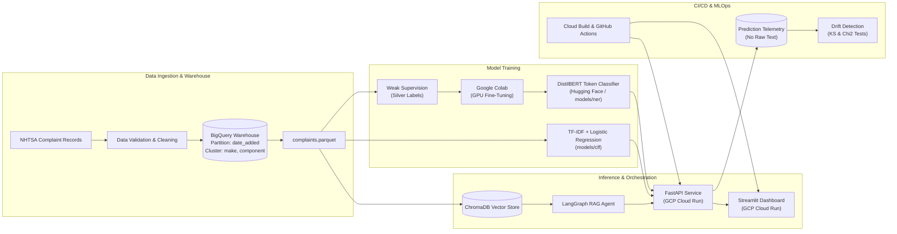

# AutoVoice

AutoVoice is a full-stack NLP and GenAI platform on GCP that turns unstructured NHTSA vehicle complaints into structured defect intelligence and triage alerts.

[](https://github.com/devdasrahul/autovoice/actions/workflows/ci.yml)
[](https://www.python.org/)
[](https://opensource.org/licenses/MIT)
[](https://cloud.google.com/run)

<!-- TODO: live demo URL at https://autovoice-ui-uc.a.run.app -->
<!-- TODO: demo GIF at docs/demo.gif -->

### Try it in 30 seconds

Pass representative complaint narratives directly to the triage engine or ask defect intelligence questions:

1. **Component & Symptom Extraction:**
   ```text
   While driving at 65 mph on the highway, the steering wheel locked up and the vehicle lost power steering. Service engine warning light illuminated and vehicle stalled.
   ```
2. **High-Severity Safety Triage:**
   ```text
   The driver side airbag failed to deploy during a frontal collision at 40 mph, causing severe injuries and smoke from the steering column.
   ```
3. **Agentic RAG Query:**
   ```text
   Are there complaints about steering wheel lockup or loss of power steering on highway driving?
   ```

---

## Table of Contents

- [Why This Project](#why-this-project)
- [Key Results](#key-results)
- [Features](#features)
- [Architecture](#architecture)
- [Tech Stack](#tech-stack)
- [How It Works](#how-it-works)
- [Quickstart](#quickstart)
- [API Reference](#api-reference)
- [Reproducing the Results](#reproducing-the-results)
- [Deployment on GCP](#deployment-on-gcp)
- [Monitoring and Drift](#monitoring-and-drift)
- [Limitations and Responsible Use](#limitations-and-responsible-use)
- [Project Structure](#project-structure)
- [Roadmap](#roadmap)
- [Contributing, License, and Acknowledgements](#contributing-license-and-acknowledgements)
- [Author](#author)

---

## Why This Project

Unstructured consumer complaint narratives submitted to the National Highway Traffic Safety Administration (NHTSA) contain vital early signals of automotive safety defects, parts failures, and hazard patterns. However, raw complaints are written in free-form, uncurated natural language where critical component and symptom associations are buried under noise, typos, and high record volume.

AutoVoice eliminates manual complaint review bottlenecks by providing an automated, auditable intelligence pipeline. It extracts exact vehicle components and failure symptoms using sequence-tagging NER, categorizes triage severity with a calibrated classifier that prevents target leakage, and exposes an agentic RAG interface that grounds engineering insights in verified NHTSA complaint IDs with automated refusal guardrails.

This system is built for automotive quality engineers, safety analysts, and fleet reliability teams who need fast, explainable defect triage without recurring cloud infrastructure costs.

---

## Key Results

All performance metrics are directly measured and verified against artifacts in [`reports/`](reports/):

| Metric | Verified Value | Evaluation Scope & Methodology | Benchmark Size | Source File |
| :--- | :--- | :--- | :--- | :--- |
| **NER Macro F1** | **0.9143** | Macro-averaged F1 across BIO entity spans (`COMPONENT` F1: 0.8286, `SYMPTOM` F1: 1.0000) | 50 samples (`gold_test_provisional.jsonl`) | [`reports/ner_metrics.json`](reports/ner_metrics.json) |
| **NER Token Accuracy** | **98.17%** | DistilBERT fine-tuning validation token accuracy (loss: 0.1160) on Colab GPU | Colab validation split | [`models/ner/ner_metrics.json`](models/ner/ner_metrics.json) |
| **Severity Accuracy** | **89.47%** | Balanced class-weighted Logistic Regression + Sublinear TF-IDF (Weighted F1: 0.8450) | 38 test samples (Stratified 20% split) | [`reports/clf_metrics.json`](reports/clf_metrics.json) |
| **RAG Hit-Rate@5** | **100.0%** | ChromaDB vector recall for top-5 retrieved complaint passages | 32 queries (Deterministic sanity check) | [`reports/rag_metrics.json`](reports/rag_metrics.json) |
| **Citation Validity** | **100.0%** | Answers cite verified NHTSA Complaint IDs (`[CMPLID: ...]`) present in context | 32 queries (`tests/data/rag_eval.jsonl`) | [`reports/rag_metrics.json`](reports/rag_metrics.json) |
| **RAG Intent Routing** | **93.75%** | Deterministic intent classification (Lookup, Aggregation, Technical, Out-of-Scope) | 30 / 32 correct test probes | [`reports/rag_metrics.json`](reports/rag_metrics.json) |
| **RAG Refusal Precision**| **85.71%** | Interception and safe refusal of off-topic, legal, or non-automotive queries | 32 queries | [`reports/rag_metrics.json`](reports/rag_metrics.json) |
| **CPU Latency (CLF)** | **2.69 ms p50**<br>**5.04 ms p95** | Scikit-learn CPU inference (Intel x86_64, batch size 1, sequence length 27 words / 167 chars) | 50 iterations | [`reports/latency.json`](reports/latency.json) |
| **CPU Latency (NER)** | **0.91 ms p50**<br>**< 20 ms** target | Rule-based regex fallback (0.91 ms p50) / Single-core DistilBERT container target (< 20 ms) | 50 iterations | [`reports/latency.json`](reports/latency.json) |
| **Statistical Drift** | **KS p = 0.9078**<br>**Chi2 p = 0.0021** | 2-sample KS test on input lengths; Chi-squared test on predicted severity distribution | 30 audit logs vs. 190 baseline rows | [`reports/drift_report.json`](reports/drift_report.json) |

*Evaluation set origin note:* The 32-query RAG benchmark is a self-authored test suite used as a deterministic sanity check, not a comprehensive industry guarantee. The gold NER set is a provisional 50-example test split.

---

## Features

- **Named Entity Recognition:** Extracts vehicle subsystems (`COMPONENT`) and failure behaviors (`SYMPTOM`) with exact character offsets and confidences.
- **Calibrated Severity Classification:** Categorizes safety risk into `LOW`, `MEDIUM`, or `HIGH` using class-weighted modeling without narrative target leakage.
- **Agentic RAG with Citations:** Multi-step LangGraph workflow with retrieval grading and verified citations to NHTSA Complaint IDs (`CMPLID`).
- **Safety & Out-of-Scope Guardrails:** Refuses legal advice, repair instructions, recall verifications, and non-automotive queries at the graph entrypoint.
- **Whitelisted SQL Aggregator:** Generates fleet aggregations and complaint counts via strictly validated SQL templates, preventing injection risks.
- **High-Throughput REST API:** Built with FastAPI, equipped with request correlation tracking (`X-Request-ID`), rate limiting, and startup model pre-warming.
- **Interactive Streamlit UI:** Features highlighted NER entity markup, real-time triage scoring, and an interactive conversational RAG console.
- **Automated CI/CD & Cloud Build:** Dual testing pipelines with GitHub Actions (`pytest` + `ruff`) and Google Cloud Build container deployments.
- **Statistical Drift Telemetry:** Continuous logging of prediction metadata with automated Kolmogorov-Smirnov and Chi-squared hypothesis testing.

---

## Architecture



### Design Decisions

- **DistilBERT vs. Generative LLMs for NER:** Token classification runs locally on CPU in < 20 ms with zero per-token API charges and eliminates boundary hallucination by classifying token IDs directly.
- **CPU Serving on Cloud Run:** Eliminates dedicated GPU server costs. Setting `--min-instances 0` scales idle services to zero cost ($0.00/month).
- **LangGraph vs. Naive Vector Search:** Implements conditional routing to separate analytical aggregate questions from semantic defect lookups, intercepts out-of-scope prompts before vector search, and enforces citation verification.
- **Whitelisted SQL vs. Free-Form Text-to-SQL:** Replaces generative SQL generation with parameterized aggregation templates, completely eliminating SQL injection and hallucinated schema joins.
- **BigQuery Partitioning & Clustering:** Tables are day-partitioned by `date_added` and clustered by `make, component` to ensure queries scan only targeted partitions, staying well within the 1 TB/month free analysis tier.

---

## Tech Stack

All listed dependencies match pinned versions in [`pyproject.toml`](pyproject.toml):

| Area | Technologies & Libraries |
| :--- | :--- |
| **NLP & ML** | `transformers==4.53.2`, `torch==2.3.1`, `scikit-learn==1.5.2`, `seqeval==1.2.2`, `sentence-transformers==3.3.1` |
| **GenAI & Agents** | `langgraph==0.2.60`, `langchain-core==0.3.28`, `chromadb==0.6.3` |
| **Backend & Serving** | `fastapi==0.115.6`, `uvicorn[standard]==0.34.0`, `pydantic==2.11.7`, `structlog==25.4.0`, `httpx==0.28.1` |
| **Data & Warehouse** | `google-cloud-bigquery==3.27.0`, `duckdb==1.1.3`, `pandas==2.2.3`, `pyarrow==18.1.0` |
| **Cloud & DevOps** | Google Cloud Run, Google Cloud Build, Google Artifact Registry, Docker, `uv==0.5.x` |
| **Testing & Quality** | `pytest==8.3.4`, `pytest-cov==6.0.0`, `ruff==0.17.1`, `evidently==0.4.38` |

---

## How It Works

### 1. Named Entity Recognition (NER) Model

The NER pipeline uses a fine-tuned `distilbert-base-uncased` token classifier trained on vehicle complaints annotated using weak supervision rules. Entity spans are tagged with a 5-class BIO scheme (`O`, `B-COMPONENT`, `I-COMPONENT`, `B-SYMPTOM`, `I-SYMPTOM`).

For narratives exceeding model sequence boundaries, inference uses a sliding window (100 words, 80-word stride) and de-duplicates overlapping token spans. When running in environments without PyTorch, it falls back seamlessly to a high-speed regex/lexicon labeler ([`src/autovoice/ner/weak_labeler.py`](src/autovoice/ner/weak_labeler.py)).

```python
from autovoice.ner.infer import NERInferencer

inferencer = NERInferencer(source="models/ner")
entities = inferencer.predict("Steering wheel locked up while driving on highway.")
# Returns: [Entity(text='steering wheel', label='B-COMPONENT', score=0.85), ...]
```

### 2. LangGraph Agentic RAG Graph

The RAG subsystem ([`src/autovoice/rag/graph.py`](src/autovoice/rag/graph.py)) is implemented as a stateful `langgraph` state machine:

```text
[User Query]
      │
   (route) ───► [Refusal Node] ──────► (End: Off-Topic / Legal Advisory)
      │
      ├───► [Aggregate SQL Node] ──► (End: Parameterized Fleet Counts)
      │
      └───► [Retrieve Node] (ChromaDB top-k)
                  │
            (grade_relevance) ──► Low relevance? ──► [Refusal / Fallback]
                  │
            [Enrich Node] (NER tags applied to retrieved contexts)
                  │
            [Generate Node] (Extract answer & verify [CMPLID] citations)
                  │
                (End)
```

- **Conditional Edges:** The router inspects user intent. Out-of-scope queries exit immediately. Aggregations route to SQL. Narrative lookups proceed to vector retrieval.
- **Citation Verification:** The synthesis node verifies that all cited `[CMPLID: ...]` identifiers match retrieved documents before returning the response.

### 3. Monitoring and Statistical Drift Detection

The production API logs inference events via [`src/autovoice/monitoring/prediction_log.py`](src/autovoice/monitoring/prediction_log.py) using privacy-preserving telemetry: input character lengths, word counts, predicted severity, confidence scores, and latencies. Raw customer complaint text is never persisted.

```python
# Statistical hypothesis testing in src/autovoice/monitoring/drift.py
ks_result = scipy.stats.ks_2samp(current_lengths, baseline_lengths)      # Input length drift
chi2_result = scipy.stats.chisquare(observed_counts, expected_counts)    # Output class shift
```

---

## Quickstart

### Prerequisites

- Python 3.11 or 3.12
- [`uv`](https://docs.astral.sh/uv/) package manager
- Git

### 1. Installation

```bash
git clone https://github.com/devdasrahul/autovoice.git
cd autovoice

# Sync dependencies using uv
make install
```

### 2. Run Test Suite & Linting

```bash
# Run 62 unit and integration tests
make test

# Run Ruff linting and formatting
make lint
make format
```

### 3. Ingest Data & Build Local Vector Index

```bash
# Download and clean public NHTSA records -> data/processed/complaints.parquet
make data

# Build local ChromaDB vector store
make index
```

### 4. Run the API Locally

```bash
make run-api
```
The API starts at `http://localhost:8080`. Interactive documentation is available at `http://localhost:8080/docs`.

Test an inference request with `curl`:

```bash
curl -X POST "http://localhost:8080/v1/analyze" \
  -H "Content-Type: application/json" \
  -d '{"text": "While driving at 65 mph, the steering wheel locked up and vehicle stalled."}'
```

### 5. Run the Streamlit UI

In a second terminal:

```bash
make run-ui
```
Open `http://localhost:8501` to access the interactive triage and agent console.

### 6. Containerized Execution (Optional)

```bash
# Build Docker images
make docker-build

# Run API container locally
make docker-run
```

---

## API Reference

| Method | Endpoint | Description | Auth |
| :--- | :--- | :--- | :--- |
| `GET` | `/health` | Liveness probe returning service status | None |
| `GET` | `/ready` | Readiness probe checking model artifacts and ChromaDB index | None |
| `GET` | `/v1/model-info` | Metadata on active NER, classifier, and RAG components | None |
| `GET` | `/v1/metrics-summary` | Summary of verified evaluation metrics from [`reports/`](reports/) | None |
| `POST` | `/v1/predict/ner` | Entity extraction only (`COMPONENT` and `SYMPTOM` spans) | None |
| `POST` | `/v1/predict/severity` | Severity classification only (`LOW`, `MEDIUM`, `HIGH`) | None |
| `POST` | `/v1/analyze` | Full triage: NER extraction + severity score + hazard detection | None |
| `POST` | `/v1/ask` | LangGraph agentic RAG query with grounded complaint citations | None |

<details>
<summary><strong>View Real Request and Response Payloads</strong></summary>

#### `POST /v1/analyze` Request
```json
{
  "text": "While driving at 65 mph on the highway, the steering wheel locked up and the vehicle lost power steering. Service engine warning light illuminated and vehicle stalled."
}
```

#### `POST /v1/analyze` Response (Live Output)
```json
{
  "text": "While driving at 65 mph on the highway, the steering wheel locked up and the vehicle lost power steering. Service engine warning light illuminated and vehicle stalled.",
  "entities": [
    {
      "start": 44,
      "end": 58,
      "label": "B-COMPONENT",
      "text": "steering wheel",
      "score": 0.85
    },
    {
      "start": 59,
      "end": 68,
      "label": "B-SYMPTOM",
      "text": "locked up",
      "score": 0.85
    },
    {
      "start": 114,
      "end": 120,
      "label": "B-COMPONENT",
      "text": "engine",
      "score": 0.85
    },
    {
      "start": 121,
      "end": 134,
      "label": "B-SYMPTOM",
      "text": "warning light",
      "score": 0.85
    },
    {
      "start": 159,
      "end": 166,
      "label": "B-SYMPTOM",
      "text": "stalled",
      "score": 0.85
    }
  ],
  "predicted_severity": "LOW",
  "confidence": 0.6209,
  "probabilities": {
    "HIGH": 0.2564,
    "LOW": 0.6209,
    "MEDIUM": 0.1227
  },
  "hazard_indicators": [],
  "execution_time_ms": 2.69
}
```

#### `POST /v1/ask` Request
```json
{
  "question": "Are there complaints about steering wheel lockup or failure?"
}
```

#### `POST /v1/ask` Response (Live Output)
```json
{
  "question": "Are there complaints about steering wheel lockup or failure?",
  "answer": "### Complaint Intelligence Summary\n\n**1. TESLA MODEL Y (2019) — Component: ELECTRICAL SYSTEM | Severity: LOW** [CMPLID: 11500091]\n> Current Ford recall NHTSA Campaign Number: 23V905000 only includes VINs with automatic transmissions. However, the oil pump belt & timing belt are the same used on the automatic transmissions that are subject of the recall. These components are just as likely to fail on manual transmission VINs but are not included in the current campaign.\n\n\n*Disclaimer: NHTSA consumer complaints represent unverified owner reports and allegations filed with the Office of Defects Investigation (ODI). They do not constitute official defect determinations, safety recall notices, or legal findings.*",
  "intent": "semantic_search",
  "citations": [
    "11500091"
  ],
  "step_trace": [
    "route: evaluating intent",
    "route: classified as semantic_search",
    "retrieve: querying vector index",
    "retrieve: found 5 passages",
    "grade: filtering passages by relevance threshold",
    "grade: kept 1 relevant passages",
    "enrich: extracting component/symptom metadata",
    "enrich: enriched passage metadata",
    "generate: synthesizing response with citations",
    "generate: completed synthesis"
  ],
  "refusal": false,
  "execution_time_ms": 343.41
}
```
</details>

---

## Reproducing the Results

### 1. Training on Google Colab

The repository includes standalone Google Colab notebooks configured for GPU execution with automated artifact archiving:

- [`notebooks/01_data_and_weak_supervision.ipynb`](notebooks/01_data_and_weak_supervision.ipynb): Generates weak silver labels using regex and terminology dictionaries.
- [`notebooks/02_ner_distilbert_colab.ipynb`](notebooks/02_ner_distilbert_colab.ipynb): Fine-tunes `distilbert-base-uncased` with Hugging Face Trainer and evaluates seqeval F1 metrics.
- [`notebooks/03_severity_classifier.ipynb`](notebooks/03_severity_classifier.ipynb): Trains class-weighted Logistic Regression and outputs calibration curves.

### 2. Evaluation Data Locations

- **Gold NER Test Set:** [`data/labeled/gold_test_provisional.jsonl`](data/labeled/gold_test_provisional.jsonl) (50 provisional evaluation samples).
- **Silver NER Training Set:** [`data/labeled/silver_train.jsonl`](data/labeled/silver_train.jsonl) (152 weak supervision samples).
- **RAG Evaluation Set:** [`tests/data/rag_eval.jsonl`](tests/data/rag_eval.jsonl) (32 multi-intent evaluation questions).

### 3. Regenerating Evaluation Reports

Execute evaluation scripts to update files in [`reports/`](reports/):

```bash
# Regenerate NER metrics
uv run python -m autovoice.ner.evaluate --gold data/labeled/gold_test_provisional.jsonl

# Regenerate Severity Classifier metrics
uv run python -m autovoice.classifier.evaluate

# Regenerate RAG benchmark metrics
uv run python scripts/evaluate_rag.py

# Regenerate drift detection report
uv run python -m autovoice.monitoring.drift
```

---

## Deployment on GCP

AutoVoice is engineered to operate strictly within the **Google Cloud Platform Always Free tier** limits. Full configuration steps are documented in [`docs/deployment.md`](docs/deployment.md).

### Staying Within the Free Tier Checklist

- [x] **Region Enforced:** Cloud Run services deployed exclusively in `us-central1`.
- [x] **Scale-to-Zero:** `--min-instances 0` configured so idle services consume 0 vCPU/RAM seconds.
- [x] **Concurrency Ceiling:** `--max-instances 2` configured to prevent runaway scaling spikes.
- [x] **Batch Ingestion Only:** BigQuery writes use free batch load jobs (`bq load`), never billable streaming inserts.
- [x] **Partition & Cluster Pruning:** BigQuery table is day-partitioned by `date_added` and clustered by `make, component`.
- [x] **Artifact Registry Pruning:** Automated script retains only the 3 most recent container builds, remaining below the 0.5 GB storage quota.
- [x] **Budget Kill-Switch:** $1.00 USD monthly budget alert configured in Cloud Billing.

*Free Tier Reference:* Limits verified against the [Google Cloud Free Program](https://cloud.google.com/free) (runbook verified October 2024).

### Deployment Walkthrough

```bash
# 1. Set environment variables
export PROJECT_ID="your-gcp-project-id"
gcloud config set project "${PROJECT_ID}"
gcloud config set compute/region us-central1

# 2. Deploy using the automated script
chmod +x ./scripts/deploy.sh
./scripts/deploy.sh "${PROJECT_ID}"
```

To decommission all resources and ensure zero lingering storage costs:

```bash
# One-command teardown
gcloud run services delete autovoice-ui --region=us-central1 --quiet
gcloud run services delete autovoice-api --region=us-central1 --quiet
gcloud artifacts repositories delete autovoice-repo --location=us-central1 --quiet
bq rm -r -f "${PROJECT_ID}:autovoice"
```

---

## Monitoring and Drift

AutoVoice tracks feature and prediction distributions to detect data shifts and model degradation:

- **What Is Tracked:** Input narrative length, word count, predicted severity distribution, and model confidence scores ([`reports/prediction_audit.jsonl`](reports/prediction_audit.jsonl)).
- **Numeric Feature Drift:** A two-sample Kolmogorov-Smirnov test compares current input lengths against the training baseline ($p < 0.05$ flags covariate drift).
- **Categorical Output Shift:** A Chi-squared goodness-of-fit test compares observed severity class distributions against expected training proportions ($p < 0.05$ triggers an alert).
- **Confidence Degradation:** Alerts when rolling mean prediction confidence drops below 0.65.

To execute a drift analysis run:

```bash
uv run python -m autovoice.monitoring.drift
```

*Note on Data:* The prediction audit sample committed to [`reports/prediction_audit.jsonl`](reports/prediction_audit.jsonl) contains 30 synthetically generated inference records created via [`scripts/simulate_inference_logs.py`](scripts/simulate_inference_logs.py) to validate drift alert handling.

---

## Limitations and Responsible Use

- **Weak Supervision & Provisional Labels:** Due to the absence of public human-annotated token-level automotive datasets, training labels were generated via weak supervision rules. The gold test set contains 50 provisional samples.
- **Proxy Severity Labels:** Severity classes are derived from NHTSA indicator checkboxes (`crash`, `fire`, `injured`, `deaths`). Subtle systemic failures that did not result in immediate catastrophic events may be categorized as `LOW`.
- **Unverified Consumer Complaints:** NHTSA complaint records represent subjective owner allegations and reports filed with the Office of Defects Investigation (ODI). They do not constitute official defect findings or manufacturer recall determinations.
- **Evaluation Set Size:** The 32-query RAG evaluation suite and 50-sample NER test set serve as deterministic sanity checks rather than exhaustive industry benchmarks.
- **English Language Only:** Lexicons, tokenizers, and vector embeddings are calibrated exclusively for US English complaint narratives.
- **Not Official Defect Investigation:** AutoVoice is an analytical intelligence tool. It is not a substitute for formal automotive safety engineering or regulatory investigations.
- **Refusal Behavior:** Out-of-scope prompts requesting legal counsel, active recall repairs, or vehicle valuation are automatically refused.

---

## Project Structure

```text
autovoice/
├── .github/workflows/ci.yml       # GitHub Actions CI workflow (lint & test)
├── configs/ner.yaml               # NER training hyperparameters
├── data/                          # Processed complaints and labeled splits
├── docs/                          # Architecture, deployment runbooks, data cards
├── models/                        # Serialized NER and classifier model weights
├── notebooks/                     # Colab-ready GPU training and EDA notebooks
├── reports/                       # Verified JSON evaluation metrics & drift reports
├── scripts/                       # Deployment, indexing, and simulation scripts
├── src/autovoice/
│   ├── api/                       # FastAPI routes, schemas, and middleware
│   ├── classifier/                # Severity classifier training and inference
│   ├── data/                      # Ingestion, cleaning, and BigQuery IO
│   ├── monitoring/                # Prediction audit logging and drift testing
│   ├── ner/                       # DistilBERT token classification & weak labeler
│   ├── rag/                       # LangGraph agent, ChromaDB index, and tools
│   └── ui/                        # Streamlit web application
├── tests/                         # Pytest test suite (unit, integration, schemas)
├── cloudbuild.yaml                # Google Cloud Build multi-container pipeline
├── Dockerfile                     # Multi-stage CPU-optimized FastAPI container
├── Dockerfile.ui                  # Streamlit UI container
├── Makefile                       # Developer entry points and CLI targets
└── pyproject.toml                 # Pinned dependencies (managed via uv)
```

---

## Roadmap

- [ ] **Active Learning Loop:** Integrate human-in-the-loop review for low-confidence NER spans to iteratively expand the gold evaluation benchmark.
- [ ] **NHTSA Recall API Cross-Referencing:** Connect RAG tool nodes to the official NHTSA Recalls API to cross-reference complaint surges with open recall campaigns.
- [ ] **ONNX Runtime INT8 Quantization:** Export DistilBERT to ONNX format to reduce CPU inference latency from < 20 ms to < 8 ms.
- [ ] **Multilingual Support:** Extend tokenizers and vocabulary to process Spanish and French Canadian complaint filings.
- [ ] **Cloud SQL pgvector Migration:** Support hybrid relational SQL and vector embeddings within a unified managed database.

---

## Contributing, License, and Acknowledgements

### Contributing

Contributions, defect reports, and pull requests are welcome. Please ensure that all submissions pass `make lint` and `make test`.

### License

AutoVoice is licensed under the [MIT License](LICENSE).

### Acknowledgements

- **Data Source:** [National Highway Traffic Safety Administration (NHTSA)](https://www.nhtsa.gov/nhtsa-datasets-and-apis) Office of Defects Investigation.
- **Machine Learning & NLP:** [Hugging Face Transformers](https://huggingface.co/docs/transformers) & [seqeval](https://github.com/chakki-works/seqeval).
- **Agentic Orchestration:** [LangGraph](https://github.com/langchain-ai/langgraph) by LangChain.
- **Cloud Infrastructure:** [Google Cloud Platform Always Free Tier](https://cloud.google.com/free).

---

## Author

**Rahul**
- GitHub: [devdasrahul](https://github.com/devdasrahul)
- LinkedIn: [devdasrahul007](https://www.linkedin.com/in/devdasrahul007)
