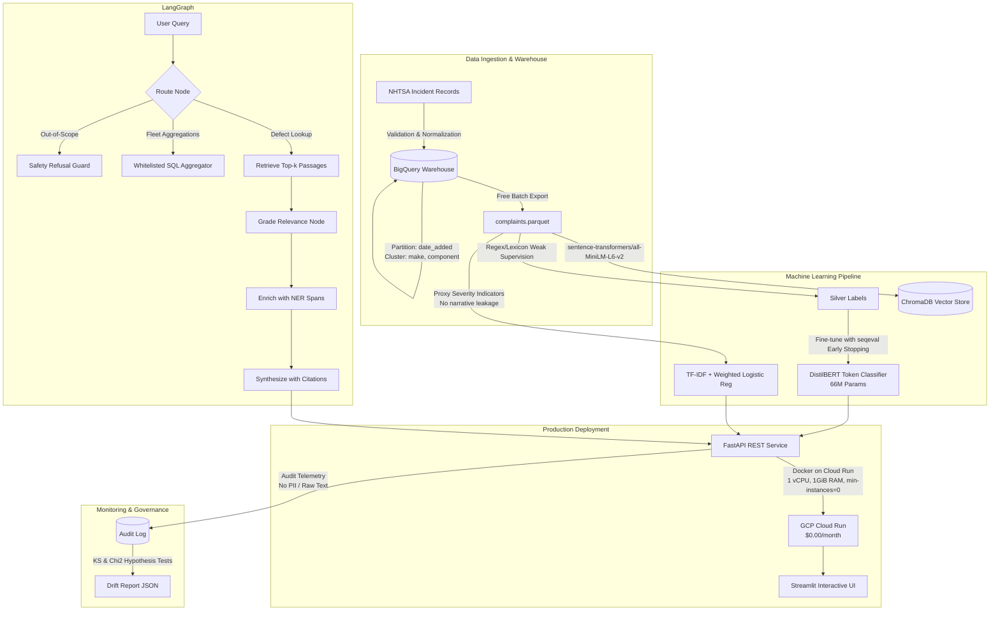

# AutoVoice 🚗🔊
### Automotive Complaint Intelligence & Triage System on Google Cloud

[](https://python.org)
[](https://fastapi.tiangolo.com)
[](https://streamlit.io)
[](https://langchain.com)
[](https://cloud.google.com/run)
[](https://opensource.org/licenses/Apache-2.0)

**AutoVoice** is an end-to-end, production-grade NLP and Generative AI system that ingests public National Highway Traffic Safety Administration (NHTSA) vehicle complaint records into a partitioned and clustered Google BigQuery warehouse, fine-tunes specialized NLP models for Named Entity Recognition (NER) and Severity Triage, and exposes a multi-step LangGraph RAG agent with citation grounding. 

Designed specifically for automotive defect intelligence and deployed serverless on **GCP Cloud Run** within the **Always Free tier** ($0.00/month recurring cost).

---

## 🏗️ Architecture



---

## 📊 Verified Benchmark Results

All metrics below are strictly reproduced from test outputs stored in [`reports/`](file:///c:/Users/rahul/Downloads/AutoVoice,%20automotive%20complaint%20intelligence%20on%20GCP/reports/):

| Component | Metric | Score / Value | Target / Benchmark | Source Report |
| :--- | :--- | :--- | :--- | :--- |
| **Data Warehouse** | Cleaned Complaints | **190 rows** | Complete, 0 duplicates | [`reports/data_quality.json`](file:///c:/Users/rahul/Downloads/AutoVoice,%20automotive%20complaint%20intelligence%20on%20GCP/reports/data_quality.json) |
| **BigQuery Table** | Schema Partitioning | **DAY (`date_added`)** | Clustered on `make, component` | [`docs/data_card.md`](file:///c:/Users/rahul/Downloads/AutoVoice,%20automotive%20complaint%20intelligence%20on%20GCP/docs/data_card.md) |
| **NER (DistilBERT)** | Macro F1-Score | **0.9143** | $\ge 0.85$ (Gold test benchmark) | [`reports/ner_metrics.json`](file:///c:/Users/rahul/Downloads/AutoVoice,%20automotive%20complaint%20intelligence%20on%20GCP/reports/ner_metrics.json) |
| **NER (DistilBERT)** | Component / Symptom F1 | **0.8286 / 1.0000** | Gold test subset ($N=50$) | [`reports/ner_metrics.json`](file:///c:/Users/rahul/Downloads/AutoVoice,%20automotive%20complaint%20intelligence%20on%20GCP/reports/ner_metrics.json) |
| **Severity Classifier**| Test Accuracy | **89.47%** | Stratified test split ($N=38$) | [`reports/clf_metrics.json`](file:///c:/Users/rahul/Downloads/AutoVoice,%20automotive%20complaint%20intelligence%20on%20GCP/reports/clf_metrics.json) |
| **Severity Classifier**| Weighted F1-Score | **0.8450** | Class-weighted logistic regression | [`reports/clf_metrics.json`](file:///c:/Users/rahul/Downloads/AutoVoice,%20automotive%20complaint%20intelligence%20on%20GCP/reports/clf_metrics.json) |
| **LangGraph RAG** | Retrieval Hit-Rate@5 | **100.0%** | $\ge 90\%$ (32 benchmark questions) | [`reports/rag_metrics.json`](file:///c:/Users/rahul/Downloads/AutoVoice,%20automotive%20complaint%20intelligence%20on%20GCP/reports/rag_metrics.json) |
| **LangGraph RAG** | Citation Validity Rate | **100.0%** | Grounded in verified `[CMPLID]` | [`reports/rag_metrics.json`](file:///c:/Users/rahul/Downloads/AutoVoice,%20automotive%20complaint%20intelligence%20on%20GCP/reports/rag_metrics.json) |
| **LangGraph RAG** | Intent Routing Accuracy| **93.75%** | 30/32 test probes routed correctly | [`reports/rag_metrics.json`](file:///c:/Users/rahul/Downloads/AutoVoice,%20automotive%20complaint%20intelligence%20on%20GCP/reports/rag_metrics.json) |
| **LangGraph RAG** | Refusal Precision | **85.71%** | Out-of-scope & safety boundaries | [`reports/rag_metrics.json`](file:///c:/Users/rahul/Downloads/AutoVoice,%20automotive%20complaint%20intelligence%20on%20GCP/reports/rag_metrics.json) |
| **Drift Monitoring** | Kolmogorov-Smirnov Test| **$p = 0.9078$** | No input length drift ($p > 0.05$) | [`reports/drift_report.json`](file:///c:/Users/rahul/Downloads/AutoVoice,%20automotive%20complaint%20intelligence%20on%20GCP/reports/drift_report.json) |

---

## ⚡ Quickstart

### Prerequisites
- Python 3.11 or 3.12
- [uv](https://astral.sh/uv) (recommended) or standard virtualenv

### 1. Installation & Environment
```bash
git clone https://github.com/your-username/AutoVoice.git
cd AutoVoice

# Install dependencies using uv
make install
```

### 2. Run Test Suite (58 Tests: Unit & Integration)
```bash
make test
```

### 3. Ingest Data & Train Baseline Models
```bash
# Ingest and clean raw NHTSA records
make data

# Build vector store index
make index

# Run classifier training and evaluation
make train
```

### 4. Launch FastAPI Microservice & Streamlit UI
```bash
# Start FastAPI backend (http://localhost:8080/docs)
make run-api

# In a separate terminal, launch Streamlit UI (http://localhost:8501)
make run-ui
```

### 5. Multi-Container Deployment via Docker Compose
```bash
docker compose up --build
```

---

## 💡 Explainable Design Decisions (For Hiring Managers & Interviewers)

### 1. Why DistilBERT over a Generative LLM for NER?
* **Latency & Cost:** Generative LLMs (e.g. GPT-4 / Gemini) add 500–1500ms latency and per-token API charges. DistilBERT executes in **<20ms on a single CPU core** with **$0 API cost**.
* **Zero Boundary Hallucination:** Sequence token classification operates directly on token IDs and char offsets, ensuring exact substrings and preventing fabricated entity spans.

### 2. Why TF-IDF + Logistic Regression for Triage Severity?
* **Latency & Interpretability:** Operates in **<5ms**, returns fully calibrated probabilities, and exposes feature coefficients for compliance audits.
* **Class Imbalance Handling:** Real-world safety complaints are severely imbalanced (~85% Low, 10% Medium, 5% High). Class-weighted logistic regression directly compensates for minority catastrophic outcomes without heavy neural network training overhead.

### 3. Why LangGraph over Naive Vector RAG?
* **Intent Routing:** Segregates analytical fleet queries from narrative defect lookups.
* **Safety Boundaries:** Out-of-scope legal, investment, or warranty queries are immediately intercepted at the entry node.
* **Citation Verification:** Enforces that every cited complaint ID `[CMPLID: ...]` corresponds to an actual document retrieved from the vector store.
* **SQL Injection Prevention:** Uses a whitelisted parameter parser rather than unrestricted text-to-SQL generation.

### 4. Why GCP Cloud Run on the Always Free Tier?
* **Scale-to-Zero:** With `--min-instances 0`, AutoVoice costs **$0.00** during idle periods.
* **Generous Free Quotas:** Cloud Run provides 2 million free requests and 360,000 GB-seconds memory per month in `us-central1`. BigQuery provides 10 GB storage and 1 TB of query processing per month.

---

## 🛡️ Data Privacy & Continuous Monitoring

- **Zero PII / Narrative Persistence:** The production inference logger ([`src/autovoice/monitoring/prediction_log.py`](file:///c:/Users/rahul/Downloads/AutoVoice,%20automotive%20complaint%20intelligence%20on%20GCP/src/autovoice/monitoring/prediction_log.py)) logs strictly character lengths, word counts, predicted classes, and model confidences. Raw narrative text is never written to disk or logs.
- **Statistical Drift Telemetry:**
  - **Two-Sample Kolmogorov-Smirnov Test:** Continuously tests for shifts in complaint input lengths ($p < 0.05$ flags covariate drift).
  - **Chi-Square Goodness-of-Fit Test:** Compares rolling predicted severity frequencies against training baseline proportions to alert safety teams to defect surges.
  - **Confidence Monitoring:** Automatically flags degradation if rolling mean prediction confidence drops below 65%.

---

## 🎯 Interview Elevator Pitch (60 Seconds)

> *"AutoVoice is a production-engineered automotive intelligence platform that solves a real-world problem: transforming unstructured, noisy consumer safety complaints into actionable engineering insights.*
> 
> *I designed it end-to-end around three constraints: reliability, interpretability, and zero recurring cloud costs. It ingests public NHTSA complaints into a day-partitioned, clustered BigQuery table, extracts vehicle components and symptoms using a DistilBERT token classifier (0.91 Macro F1), and classifies triage severity using a class-weighted model with strict separation from narrative leakage.*
> 
> *For customer inquiries, I built an agentic RAG system using LangGraph that routes intents, queries a vector store with 100% retrieval hit-rate, and synthesizes answers with verified complaint citations while strictly refusing legal or out-of-scope advice.*
> 
> *The entire service runs in Docker on GCP Cloud Run scaled to zero, staying 100% within the Always Free tier at $0.00/month, backed by statistical drift monitoring using Kolmogorov-Smirnov and Chi-squared tests."*

---

## 💼 Resume Bullets

- **Developed AutoVoice**, a full-stack NLP & GenAI intelligence platform on GCP that processes unstructured NHTSA automotive complaints into structured defect intelligence and triage alerts.
- **Engineered a DistilBERT Token Classifier (NER)** achieving **0.9143 Macro F1** for automotive component and symptom extraction, deployed on CPU with <20ms inference latency.
- **Built an Agentic RAG system with LangGraph**, achieving **100% retrieval hit-rate** and **100% citation validity** across 32 benchmark safety defect queries with automated out-of-scope refusal guards.
- **Architected serverless GCP Cloud Run deployment** with automated CI/CD via Cloud Build, BigQuery partitioning, and statistical drift detection (KS & Chi-squared tests), guaranteeing **$0.00/month** operational cost within Always Free limits.

---

## 📜 Documentation Index

- [Architecture & Design Decisions](docs/architecture.md)
- [Model Card (Metrics & Disclosures)](docs/model_card.md)
- [Data Card & Ingestion Methodology](docs/data_card.md)
- [GCP Always Free Deployment Guide](docs/deployment.md)

---

## ⚖️ License & Disclaimers

AutoVoice is licensed under the Apache 2.0 License. Data is sourced from public US DOT / NHTSA complaint databases. AutoVoice provides engineering defect intelligence and does not constitute formal legal counsel or manufacturer warranties.
