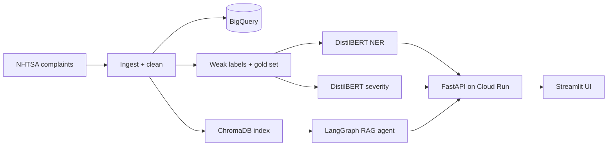

# AutoVoice 🚗🔊

**Automotive Complaint Intelligence on Google Cloud — NER + severity classification + a LangGraph RAG agent over public NHTSA vehicle complaints, built to run within the GCP Always Free tier ($0/month target).**

> Status: **Phase 1 (scaffold & tooling) complete.** Phases 2–10 (data → NER → classifier → RAG → API → UI → Docker/Cloud Run → monitoring → docs) follow the build plan; each phase lands with tests and a "STOP and report" checkpoint.

## Why this project
Public safety complaints are unstructured text full of signal: which *component* fails, with which *symptom*, how *severe* it is. AutoVoice turns that text into structured intelligence and lets anyone ask questions about it in plain English.

## Architecture (target)


## Quickstart (5 commands)
```bash
curl -LsSf https://astral.sh/uv/install.sh | sh   # install uv
cd autovoice && make install                       # sync pinned deps (uv.lock)
make lint test                                   # quality gate
make data                                        # download + clean NHTSA data (Phase 2)
make run-api                                     # FastAPI on http://localhost:8080 (Phase 6)
```

## Live demo
- API: `https://REPLACE_AFTER_DEPLOY.a.run.app` *(placeholder — filled after Phase 8 deploy)*
- UI: `https://REPLACE_AFTER_DEPLOY.a.run.app` *(placeholder)*

## Results
All numbers below come from generated files in `reports/` — never from memory. See `docs/model_card.md`.

| Metric | Value | Source file |
|---|---|---|
| NER entity-F1 (gold test set) | not measured yet | `reports/ner_metrics.json` |
| Severity macro-F1 (vs TF-IDF baseline) | not measured yet | `reports/clf_metrics.json` |
| RAG hit-rate@k / citation validity | not measured yet | `reports/rag_metrics.json` |

## Repo tour
```
src/autovoice/    config, logging, data/, ner/, classifier/, rag/, api/, monitoring/, ui/
notebooks/        Colab GPU training notebooks (Phases 3-4)
tests/            unit + integration (mocked externals)
scripts/          build_index.py, export_onnx.py, deploy.sh
docs/             architecture, model card, data card, deployment guide
```

## Cost & safety design
- CPU-only serving, `min-instances=0`, batch BigQuery loads, Artifact Registry cleanup (keep 3), $1 budget alert. Full checklist: `docs/deployment.md`.
- Weak/silver labels are rule-derived; severity labels are proxies from NHTSA indicator fields. Disclosed in the model card. Complaint data is **unverified consumer reports — not confirmed defects**; this tool gives no safety or legal advice.

## License
MIT. Data: public NHTSA/VDP complaint records (see `docs/data_card.md`).
