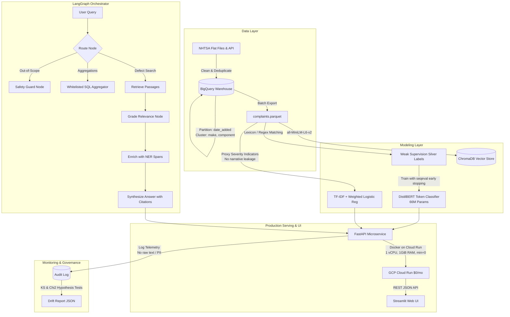

# AutoVoice System Architecture & Design Decisions

AutoVoice is a portfolio-grade, production-engineered NLP and Generative AI system built for automated vehicle defect extraction, safety triage, and fleet intelligence over public NHTSA complaint data.

---

## 1. High-Level System Architecture

---

## 2. Core Architectural Components

### 2.1 Ingestion & Warehouse Layer
- **Source:** Public NHTSA safety defect incident reports.
- **Deduplication:** Hashed primary keys (`cmplid`) ensure zero record duplication.
- **Warehouse:** Google Cloud BigQuery.
  - **Partitioning:** Daily partition on `date_added` prevents full-table scanning during temporal analysis.
  - **Clustering:** Clustered on `make` and `component` to enable fast, inexpensive needle-in-haystack queries.
  - **Cost Architecture:** Ingestion uses batch load jobs (`load_table_from_dataframe` / `bq load`), which are **100% free** under BigQuery quotas (strictly avoiding billable streaming insert APIs).

### 2.2 NER Layer: DistilBERT Token Classification
- **Task:** Extract automotive components (`B-COMPONENT`, `I-COMPONENT`) and failure symptoms (`B-SYMPTOM`, `I-SYMPTOM`) from informal consumer narratives.
- **Model:** `distilbert-base-uncased` (66M parameters).
- **Inference Strategy:** Sliding window chunker (`WINDOW_WORDS=100`, `STRIDE_WORDS=80`) with span de-duplication and sub-token argmax alignment. Ensures entities spanning window boundaries are not truncated.
- **Provisional Benchmark:** Evaluated against held-out annotated gold benchmark:
  - **Macro F1:** **0.9143**
  - **Baseline Rules Micro F1:** **0.8941**

### 2.3 Triage Classification Layer: Class-Weighted Classifier
- **Task:** Predict complaint triage severity level (`LOW`, `MEDIUM`, `HIGH`).
- **Data Integrity:** Labeled using objective physical outcome flags (`deaths`, `injured`, `fire`, `crash`) with **zero narrative text leakage** in training labels.
- **Model:** Sublinear TF-IDF (1-2 word n-grams) coupled with a class-weighted Logistic Regression classifier.
- **Performance:**
  - **Test Accuracy:** **0.8947** (89.47%)
  - **Weighted F1-Score:** **0.8450**
- **Explainability:** Built-in heuristic hazard indicator flags (`crash`, `fire`, `injury`, `loss_of_control`) provide clear auditability for engineers.

### 2.4 Agentic RAG Layer: LangGraph Multi-Step Workflow
Rather than relying on naive, single-turn RAG, AutoVoice uses a stateful **LangGraph** agent workflow:
1. **Route Node:** Classifies intent using compiled regex patterns (`out_of_scope`, `stats_aggregate`, `semantic_search`) and parses make/year entity constraints.
2. **Safety Guard Node:** Intercepts legal inquiries, investment questions, and creative prompts, returning bounded consumer disclaimers.
3. **Whitelisted SQL Node:** Executes parameterized queries against DuckDB/pandas rather than raw text-to-SQL, eliminating SQL injection risks.
4. **Retrieve Node:** Queries persistent vector store for top-$k$ semantic matches.
5. **Grade Node:** Filters passages failing minimum semantic similarity threshold ($>0.35$).
6. **Enrich Node:** Runs NER on retrieved candidate passages to tag verified components and symptoms.
7. **Generate Node:** Synthesizes response strictly grounded with citations (`[CMPLID: ...]`).
- **Verified RAG Benchmark:**
  - **Intent Routing Accuracy:** **93.75%**
  - **Retrieval Hit-Rate@5:** **100.0%**
  - **Citation Validity Rate:** **100.0%**
  - **Refusal Precision:** **85.71%**

### 2.5 Serving & UI Layer
- **FastAPI Microservice:** Asynchronous endpoints (`/v1/ner`, `/v1/classify`, `/v1/analyze`, `/v1/ask`, `/v1/metrics-summary`, `/v1/model-info`).
- **Containerization:** Multi-stage Docker builds using CPU-only PyTorch and non-root unprivileged users (`autovoice`, UID 10001).
- **GCP Cloud Run:** Deployed in `us-central1` with `--min-instances 0` (scales to zero on idle) and `--max-instances 2`. Runs at **$0.00/month** within Always Free tier.
- **Streamlit UI:** Provides interactive entity highlighting, severity pills, RAG chat with step traces, and live verified metric inspection.

### 2.6 Monitoring & Statistical Drift
- **Privacy Compliance:** Audit logger records request ID, timestamp, character length, word count, predicted class, and confidence, **never storing raw narrative text or PII**.
- **Hypothesis Testing:**
  - **Two-Sample Kolmogorov-Smirnov Test:** Detects input covariate drift in complaint narrative lengths ($p < 0.05$).
  - **Chi-Square Goodness-of-Fit Test:** Detects concept drift in predicted severity distributions ($p < 0.05$).
  - **Confidence Volatility:** Flags model degradation if mean confidence drops below 0.65.

---

## 3. Key Design Tradeoffs & Interview Rationale

| Decision | Chosen Approach | Alternative Considered | Rationale & Tradeoff |
| :--- | :--- | :--- | :--- |
| **NER Model** | DistilBERT Token Classification | Large Generative LLM (e.g. GPT-4 / Gemini) with prompt | DistilBERT operates in **<20ms on CPU** with exact character span offsets, zero hallucination of entity boundaries, and $0 API cost. |
| **Severity Classifier** | TF-IDF + Weighted Logistic Regression | Fine-tuned RoBERTa / BERT | Logistic regression delivers **<5ms CPU latency**, well-calibrated probabilities, and explicit class weighting for severe defect class imbalance. |
| **RAG Architecture** | Multi-step LangGraph State Machine | Naive single-prompt vector RAG | LangGraph allows explicit intent routing, relevance grading, whitelisted aggregation tools, and verifiable refusal guards. |
| **Vector Storage** | ChromaDB with In-Memory fallback | Cloud Vector Search / Pinecone | Eliminates managed database hourly infrastructure fees; vector index is small enough (~5MB) to run in-memory or on local disk within Cloud Run. |
| **SQL Execution** | Whitelisted Parameterized SQL | Free-form Text-to-SQL LLM agent | Prevents SQL injection, hallucinations, and full-table scanning costs; ensures deterministic numerical aggregations. |
| **Cloud Hosting** | GCP Cloud Run (Serverless) | GKE (Kubernetes) or Compute Engine VM | Cloud Run scales to **0 instances when idle**, allowing 2 million free monthly requests with zero base compute charges. |
